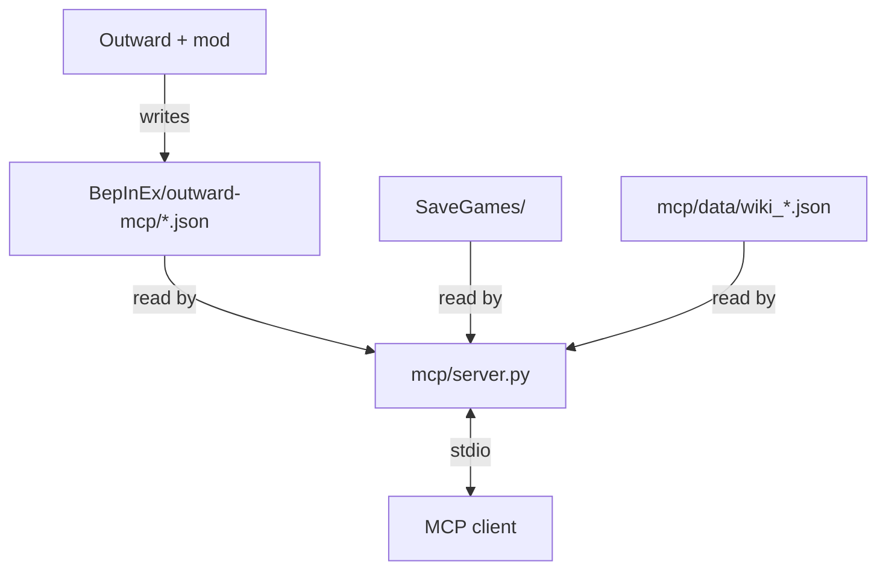

# outward-mcp

An offline, read-only helper for **Outward Definitive Edition**. It has two parts:

| Folder | What it is |
|---|---|
| `mod/` | A BepInEx plugin. It exports game data (items, recipes, status effects) and your live state as JSON. |
| `mcp/` | An MCP server. It reads that JSON, your save files and a bundled wiki snapshot, and answers questions such as "what should I do here?" or "what is worth crafting?". |

The two parts share no code. Their only link is the folder `BepInEx/outward-mcp/`: the mod writes JSON there and the server reads it.



Nothing writes to your saves. The server never uses the network.

## Requirements

- Windows. The mod build uses the C# compiler that ships with Windows (.NET Framework 4, `csc.exe`).
- Outward Definitive Edition (Steam).
- [BepInEx 5.4.23.5, Windows x64](https://github.com/BepInEx/BepInEx/releases/download/v5.4.23.5/BepInEx_win_x64_5.4.23.5.zip), the version used by the tested install.
- Python 3.9 or newer. Tested with 3.13. No packages to install.
- Optional: [Configuration Manager 19.0 for BepInEx 5](https://github.com/BepInEx/BepInEx.ConfigurationManager/releases/download/v19.0/BepInEx.ConfigurationManager_BepInEx5_v19.0.zip), to change the mod settings in game with F1.

The game folder is found through Steam. If that fails, set `OUTWARD_DIR` to the `Outward_Defed` folder, for example:

```
$env:OUTWARD_DIR = 'D:\SteamLibrary\steamapps\common\Outward\Outward_Defed'
```

## 1. Install the mod

### A. Install BepInEx

1. Close the game. In Steam, use **Manage → Browse local files**, then open `Outward_Defed`. This is the folder containing `Outward Definitive Edition.exe`, not the parent `Outward` folder.
2. Download [BepInEx 5.4.23.5 for Windows x64](https://github.com/BepInEx/BepInEx/releases/download/v5.4.23.5/BepInEx_win_x64_5.4.23.5.zip). Use BepInEx **5**, not 6, x86 or IL2CPP.
3. Extract the ZIP contents directly into `Outward_Defed`. `BepInEx/`, `winhttp.dll` and `doorstop_config.ini` must sit beside the game executable.
4. Start **Outward Definitive Edition** once, then close it. Check that `BepInEx/LogOutput.log` exists.

If BepInEx 5 is already working, skip this step. Do not overwrite an existing mod setup just to reinstall it.

### B. Install Configuration Manager (optional)

1. Download [Configuration Manager 19.0 for BepInEx 5](https://github.com/BepInEx/BepInEx.ConfigurationManager/releases/download/v19.0/BepInEx.ConfigurationManager_BepInEx5_v19.0.zip). Do not use the IL2CPP archive.
2. Extract its contents into `Outward_Defed`, merging the `BepInEx` folders. The DLL should end up at `BepInEx/plugins/ConfigurationManager/ConfigurationManager.dll`.
3. Press **F1** in game to open its settings window. Without it, edit the plugin's `.cfg` file while the game is closed.

### C. Install Outward Data Export (this mod)

There is no prebuilt DLL download in this repository yet. Build it locally; no extra Python packages or Visual Studio installation are needed.

1. [Download this repository as a ZIP](https://github.com/xynogen/outward-mcp/archive/refs/heads/main.zip) and extract it, or clone it with Git. Open PowerShell in the extracted repository folder (the one containing `mod/` and `mcp/`).
2. With the game closed, build and install the plugin:

   ```
   python mod/build.py
   ```

   This compiles `mod/*.cs` against your game and copies `OutwardDataExport.dll` to `BepInEx/plugins/OutwardDataExport/`.
   This plugin does not require SideLoader, RaidMode or UtilityPack. Configuration Manager is optional.
3. Start the game and load a character.
4. Check `BepInEx/outward-mcp/status.json`. Each file shows `ok <count>` or an error:

   ```json
   {"schema": 3, "plugin_version": "1.3.0", "files": {"items.json": "ok 2547", "recipes.json": "ok 436", "statuses.json": "ok 252", "live.json": "ok 30"}}
   ```

To check the mod code without the game (JSON writer, description placeholders):

```
python mod/build.py --check
```

### What the mod writes

| File | Content | Written |
|---|---|---|
| `items.json` | Every item and skill by id: stats, damage, resistances, tags, value, weight | once per session |
| `recipes.json` | Every crafting recipe: station, result and ingredient ids and names | once per session |
| `statuses.json` | Every status effect: description with real numbers, duration, buff or debuff | once per session |
| `live.json` | Your character: vitals, area, silver, all items, enemies around you | every `IntervalSeconds` |
| `status.json` | Result of each export, plugin version, schema version | when a result changes |

Empty values are left out: a key in the JSON always carries information.

### Mod settings

Set in game with Configuration Manager (F1), or in `BepInEx/config/xynogen.outward.dataexport.cfg`:

| Setting | Default | Range | Meaning |
|---|---|---|---|
| `Live.Enabled` | `true` | | Write `live.json` |
| `Live.IntervalSeconds` | `15` | 1 to 300 | Seconds between `live.json` updates |
| `Live.ScanRadius` | `50` | 5 to 500 | Meters around you to list enemies in `live.json` |

## 2. Set up the MCP server

Add the server to your MCP client. The command is `python` and the argument is the full path to `mcp/server.py`:

```json
{
  "mcpServers": {
    "outward": {
      "command": "python",
      "args": ["C:/path/to/outward-mcp/mcp/server.py"]
    }
  }
}
```

The key that holds the server list differs between clients (`mcpServers`, `servers`...). Check your client's documentation.

Check the server against your install:

```
python mcp/selftest.py
```

It runs every tool against your real saves with networking blocked, and prints one `ok:` line.

The server works without the mod, but with less: item facts and recipes then come from the wiki snapshot, and `get_live`, `get_nearby_enemies` and the live parts of `get_guide` have no data.

### Tools

| Tool | Answers |
|---|---|
| `get_guide` | Start here. Warnings (low health, food, drink, sleep), where you are, active quests, quests to start here, nearby enemies, best crafts |
| `get_area_guide` | An area (default: the current one): places, quests with your status, enemies with their weakness, NPCs, gathering nodes, merchants, chests with loot |
| `get_nearby_enemies` | Enemies around you: distance, compass direction, health, resistances, weakness |
| `get_craft_advice` | What is worth crafting from live inventory (save fallback): by value gained, per-type stat comparison vs worn gear, plus recipes you are one ingredient short of |
| `get_craftable` | Every recipe you can craft now with what you carry |
| `lookup` | Wiki facts by name: quests, enemies, NPCs, skills, locations, gathering, effects, traps, spells, buildings |
| `get_item` | Item facts by id or name |
| `get_live` | Raw `live.json` |
| `get_inventory` | Items, vitals, status effects and silver from a save |
| `get_world` | Day, time, season, quests, visited areas |
| `get_merchants` | Merchant stock and prices, as of your last visit |
| `get_area_loot` | Chests with loot and items on the ground in a visited area |
| `list_characters`, `list_snapshots` | Your characters and their saves |
| `list_save_files`, `read_save_file` | Raw save files as JSON |

Save tools accept `character` (number, name or id) and `snapshot` (0 = latest save).

### Where the data comes from

| Source | Used for | Fresh when |
|---|---|---|
| Mod JSON | Item stats, recipes, statuses, live state | Game running (live), or since the last game start |
| Save files | Inventory, quests, merchants, chests | Last save. Items picked up since then are not counted |
| `mcp/data/wiki_*.json` | Quests, locations, enemies, NPCs, skills, gathering, effects | When the snapshot was taken |

Game data wins over wiki data for the same item.

To refresh the wiki snapshot (this is the only step that uses the network; it reads outward.wiki.gg):

```
python mcp/data/fetch_wiki.py
```

## Troubleshooting

| Symptom | Cause and fix |
|---|---|
| `build.py`: "the game has the old one loaded" | The game locks the DLL. Close Outward, run `python mod/build.py` again. |
| `build.py`: "Outward not found via Steam" | Set `OUTWARD_DIR` to the `Outward_Defed` folder. |
| No `BepInEx/outward-mcp/` folder | The mod did not load. Check `BepInEx/LogOutput.log` for `Loading [Outward Data Export ...]`. |
| A file in `status.json` shows `error: ...` | The export failed; the old file stays. The message names the cause. Report it with the plugin version. |
| `status.json` shows `skipped N` | N entries threw an error and were left out. The rest of the file is fine. |
| `live.json` does not update | The game is on the menu or loading, or `Live.Enabled` is off. |
| `nearby` is always empty | No targetable enemies within `ScanRadius`, or you are in a town. Only enemies the game has loaded are listed. |
| An enemy has no `weakness` | Its in-game name does not match a wiki page title. |
| MCP client shows old tools | Reconnect or restart the server after updating the code. |

## Development

- Mod: C# 5 only (the Windows compiler supports nothing newer). `python mod/build.py --check` runs `mod/ModCheck.cs.txt`.
- When a JSON shape changes, bump `Schema` in `mod/OutwardDataExport.cs` and update the readers in `mcp/outward/repositories.py`.
- Server: `python mcp/selftest.py` after every change.
